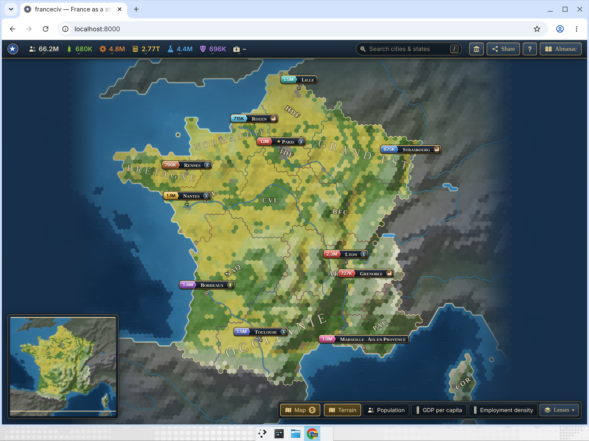

# franceciv: France as a strategy game, built from real data

A French adaptation of Andrej Karpathy's MIT-licensed [`usaciv`](https://karpathy.ai/usaciv/) visualizer.
The original browser engine, rendering art, interaction model and pipeline architecture are vendored here with attribution; this repository replaces the United States data spine with French public data.

**Live website: [www.arthurpham.com/franceciv](https://www.arthurpham.com/franceciv/).**

**Current status: France MVP.** It renders metropolitan France, Corsica and five overseas department-region insets at 8 km hex resolution, with régions, départements, INSEE aires d'attraction des villes, terrain, land cover, population, GDP and employment-derived yields.



## What works in the MVP

- Painted hex terrain from ETOPO1 elevation and CORINE Land Cover 2018 land cover; overseas elevation is included, while CORINE land-cover lenses remain metropolitan-only.
- 18 régions and 101 départements from Etalab contour files, with Guadeloupe, Martinique, Guyane, La Réunion and Mayotte affine-placed as cartographic insets.
- 699 city banners covering INSEE 2020 aires d'attraction des villes (AAV), including overseas AAVs and cross-border AAVs restricted to their French communes; small areas appear through zoom-dependent de-cluttering and search.
- Five yields: Food, Production, Gold, Science and Culture.
  - Gold is Eurostat NUTS-3 GDP in current euros.
  - The other yields are census workplace employment by industry, observed directly for each aire d'attraction.
  - AAV GDP remains an estimate: department GDP is allocated in proportion to workplace employment.
- Population, prosperity, housing, election, natural-hazard and climate lenses, including income, poverty, unemployment, education, age, immigration, commuting, growth, homeownership, vacancy, 2022 presidential results, GASPAR catastrophe recognitions, temperature, warming and rainfall.
- Power-generation and storage resources from the national ODRÉ registry: nuclear, hydro, pumped storage, tidal, gas/coal, wind, solar and batteries.
- Detailed named watercourses from IGN BD CARTO, schematic roads and official active SNCF railway geometry, real airports and ports, busy SNCF passenger stations, commune-derived fiber, EV-charging and mobile-site lenses, DVF housing-price lenses, DREES healthcare-access lenses, CORINE vineyard/orchard and Agreste farm-structure lenses, INSEE hotel-tourism intensity, Enedis electricity-use lenses, recorded-crime lenses, school-density lenses, INSEE everyday-services and sports/culture lenses, INPN Natura 2000 protected-nature lenses, and a physical river-flood exposure lens.

- UNESCO World Heritage wonders from the official UNESCO XML export, plus the most-visited Musées de France and largest universities from ministry open data.
- Regional road, rail and inland-water freight routes from SDES 2019 goods-flow tables.
- The original interactive map, city panels, minimap, sharing, searchable/favorite lens catalog, coverage-aware legends, and lens histogram UI, plus search and compact public-data cards for metropolitan and overseas communes, including EPCI/intercommunality names and populations.

## Explicitly not in the MVP yet

Citizens, districts, infrastructure, wonders, elections, natural hazards and historical defense-base personnel now use French public data. Some detailed panel assumptions and lesser-used inherited advisor copy still need France-specific review.

Other known limitations:

- AAV GDP remains allocated from department GDP using workplace-employment shares; it is an estimate, not a true AAV account.
- Road and rail geometry is schematic Natural Earth cartography, not an exhaustive network inventory.
- Election and hazard lenses are currently aggregated from communes to departments because the browser contract does not yet carry a commune hex index.
- Catastrophe-naturelle counts are administrative recognition frequency. The separate flood-exposure lens is a raster-sampled rare/millennial river-overflow estimate, not parcel-level risk or damage.
- UNESCO serial properties are represented by one French component point rather than full site boundaries. Museum attendance sums distinct physical sites sharing one Muséofile institution; universities are mapped at administrative headquarters communes rather than campus footprints.
- Overseas France is excluded; Corsica is included. Enedis does not serve Corsica and some local-distribution areas, so the electricity-use lens reflects network coverage as well as demand.
- Freight is inter-regional only, non-directional, excludes foreign trade and has suppressed rail cells. Military markers use a sparse 2012 Ministry personnel table: they are historical base-seat aggregates, not current units, boundaries, ranges or a full order of battle.

## Quick start

Install [uv](https://docs.astral.sh/uv/), then:

```bash
uv run python -m pipeline serve
```

Open the printed local URL. The generated data in `web/data/` is committed, so no download is required for viewing.

## Rebuilding the data

```bash
uv run python -m pipeline fetch fr_boundaries fr_aav natural_earth etopo fr_corine fr_eurostat fr_energy fr_climate fr_hydrography fr_rail_network fr_rail_stations fr_broadband fr_ev_charging fr_mobile_network fr_housing fr_healthcare fr_tourism fr_electricity fr_crime fr_schools fr_public_equipment fr_nature fr_flood fr_insee_stats fr_transport fr_unesco fr_elections fr_hazards fr_freight fr_culture fr_military
uv run python -m pipeline process fr_boundaries fr_aav natural_earth etopo fr_corine fr_eurostat fr_energy fr_climate fr_hydrography fr_rail_network fr_rail_stations fr_broadband fr_ev_charging fr_mobile_network fr_housing fr_healthcare fr_tourism fr_electricity fr_crime fr_schools fr_public_equipment fr_nature fr_flood fr_insee_stats fr_transport fr_unesco fr_elections fr_hazards fr_freight fr_culture fr_military
uv run python -m pipeline build world france_core climate hydrography connectivity quality_life agriculture tourism electricity public_services nature flood citizens districts military resources infrastructure wonders trade communes catalog
```

Downloads are cached under `data/raw/` with provenance manifests. Generated browser data is written to `web/data/`.

## Data sources

- Etalab / geo.api.gouv.fr: current région, département and commune boundaries, commune populations/centroids, and EPCI reference data.
- INSEE: 2020 aires d'attraction des villes, 2026 vintage geography.
- Eurostat regional accounts: `nama_10r_3gdp`, `nama_10r_3gva`, `nama_10r_3empers` for 2024.
- CORINE Land Cover 2018, served through the IGN Géoplateforme WMS.
- ODRÉ national registry of electricity generation and storage installations.
- Météo-France SIM2 monthly climate reanalysis, 1961–2025.
- IGN BD CARTO named watercourse segments.
- SNCF Gares & Connexions station traffic and station reference coordinates.
- ARCEP Ma connexion internet commune technology-eligibility statistics.
- OpenParcels commune medians derived from DGFiP/Etalab DVF transactions.
- DREES localized potential accessibility (APL) to health professionals.
- INSEE Melodi tourist-accommodation occupancy statistics.
- Enedis annual electricity consumption by commune and activity sector, aggregated by department.
- Ministry of the Interior departmental recorded-crime statistics.
- INSEE Base permanente des équipements 2024 detailed equipment registry.
- Ministry of National Education school directory.
- INPN Natura 2000 geometries through the IGN API Carto Nature module.
- TRI/Géorisques 2020 rare-or-millennial river-overflow flood surfaces, rasterized through the official WMS.
- NOAA ETOPO1 elevation and bathymetry.
- Natural Earth 1:50m neighbouring countries, lakes and rivers; 1:10m roads, railroads and ports.
- OurAirports and Eurostat `avia_paoa` / `mar_go_aa` transport traffic.
- UNESCO World Heritage Centre official XML export.
- Ministry of the Interior definitive 2022 presidential election results, mirrored on data.gouv.
- GASPAR catastrophe-naturelle recognitions from Géorisques.
- SDES 2019 road, rail and inland-waterway goods-flow workbooks.
- Ministry of Culture museum attendance and Muséofile directory; MESRI SISE university enrolment.
- Ministry of the Armed Forces: 2012 defense-base stationed personnel, preserved through the data.gouv.fr Tabular API extraction.

The in-app Almanac/source catalogue is generated from the same source registry used by the pipeline.

## Architecture

The project intentionally keeps Karpathy's simple architecture:

- `pipeline/sources/`: download and normalize source data into `data/interim/`.
- `pipeline/build/`: reconcile data onto the shared hex grid and write browser JSON contracts.
- `web/`: dependency-free ES modules and Canvas 2D; no npm, framework or frontend build step.

See `docs/DATA_CONTRACTS.md` for the browser/pipeline interface. French concepts are deliberately mapped onto the original contract: région → state, département → county, and aire d'attraction des villes → metro/city. That mapping is a compatibility layer, not a claim that the legal or statistical concepts are identical.

## License and attribution

The upstream `usaciv` source is MIT-licensed and its license is preserved in `LICENSE`. France-specific modifications in this repository are also available under the MIT license. Public data remains subject to the terms of its respective publishers.
